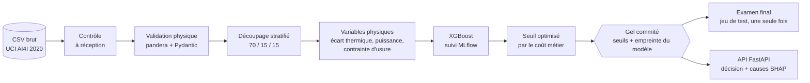
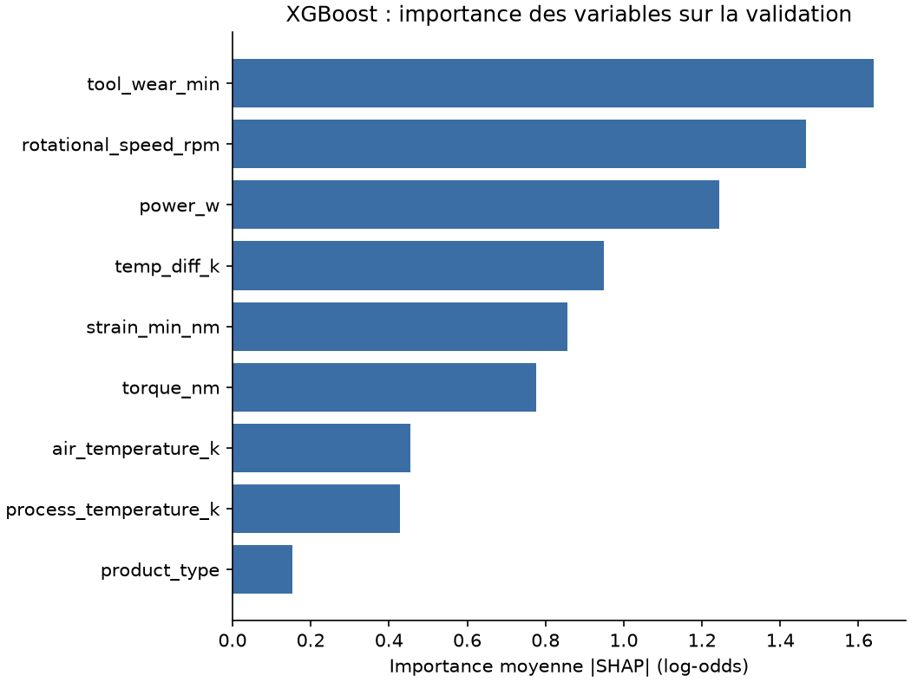

# Maintenance prédictive industrielle — AI4I 2020

[](https://github.com/ouladalireda-blip/predictive-maintenance-iot/actions/workflows/ci.yml)


**Détecter les pannes machines avant la casse, et chiffrer ce que ça rapporte en euros.**

Un modèle XGBoost, combiné à une règle de remplacement préventif de l'outil, choisit quand alerter le
technicien en minimisant le coût total (pannes ratées + fausses alertes). Le protocole d'évaluation a été
**figé et commité avant l'ouverture du jeu de test**.

---

## Résultats clés (jeu de test jamais vu, 1 500 cycles)

| Approche | Pannes détectées | Fausses alertes | Coût total* | vs maintenance corrective | Part du gain maximal |
|---|---|---|---|---|---|
| Maintenance corrective (aucune détection) | 0 / 51 | 0 | 153 000 € | — | 0 % |
| Préventif systématique (outil changé à 200 min) | 19 / 51 | 119 | 113 850 € | −26 % | 30 % |
| **Hybride XGBoost + préventif** (approche principale) | **49 / 51** | 120 | **24 000 €** | **−84 %** | **99,9 %** [IC 95 % : 99,6–100] |
| XGBoost seul (approche secondaire) | 46 / 51 | 19 | 17 850 € | −88 % | 104,6 % [IC 95 % : 95–114] |
| *Référence : règles exactes du générateur* | 49 / 51 | 119 | 23 850 € | −84 % | 100 % |

\* Coûts **estimés** : 3 000 € par panne ratée, 150 € par fausse alerte (voir [hypothèses](docs/hypotheses-couts.md)).

- Le modèle détecte **100 % des pannes de surchauffe, de puissance et de surcharge**, sur la validation comme sur le test, **sans connaître les règles** qui les ont générées.
- L'hybride récupère **au moins 99 % du gain maximal pour tous les rapports de coût testés (5 à 50)**.
- Les **variables physiques** construites (écart thermique, puissance, contrainte d'usure) apportent **+0,12 de PR-AUC** (ablation).

> La « part du gain maximal » compare le gain d'une approche à celui des **règles exactes du générateur
> AI4I**. Ces règles sont inaccessibles en usine réelle : elles servent de borne haute, pas de concurrent.

---

## Le problème

Sur une ligne d'usinage, une panne non anticipée coûte un arrêt non planifié, de la casse et des
rebuts. Une fausse alerte coûte une inspection inutile. Le responsable maintenance veut savoir
**quand intervenir**, et **combien** une détection automatique peut faire économiser par rapport à :

- la maintenance **corrective** (on répare quand ça casse) ;
- la maintenance **préventive systématique** (on change l'outil à intervalle fixe).

---

## Architecture



---

## Données

**Source :** AI4I 2020 Predictive Maintenance Dataset, UCI Machine Learning Repository, licence CC BY 4.0.
https://doi.org/10.24432/C5HS5C

10 000 cycles de fabrication, 3,4 % de pannes, 5 modes de panne : usure outil (TWF), dissipation thermique
(HDF), puissance (PWF), surcharge (OSF) et aléatoire (RNF).

**Limites assumées :**

- **Données synthétiques**, générées par des règles physiques connues. Un modèle peut donc les retrouver
  presque parfaitement : d'où la comparaison à ces règles comme borne haute.
- **Pas de série temporelle** : chaque ligne est un instantané indépendant. Le modèle produit un
  **score de risque à l'instant t**, pas une durée de vie restante. Aucun gain de MTBF ou de TRS n'est revendiqué.
- Les colonnes `TWF`, `HDF`, `PWF`, `OSF`, `RNF` **décrivent la panne elle-même** : elles sont interdites
  comme variables (fuite de données), et ce point est vérifié par des tests.

---

## Méthode

### 1. Des données fiables
- **Contrôle à réception** : colonnes, nombre de lignes et de pannes.
- **Validation physique** : bornes de plausibilité issues de la configuration (une mesure impossible est rejetée, pas devinée).
- **Découpage stratifié 70/15/15** avec graine fixe, avant toute transformation apprise, sans ligne commune entre les lots (testé).

### 2. Des variables guidées par la physique

| Variable | Calcul | Mécanisme de panne |
|---|---|---|
| `temp_diff_k` | T° process − T° air | Dissipation thermique (HDF) |
| `power_w` | Couple × vitesse × 2π / 60 | Puissance hors plage (PWF) |
| `strain_min_nm` | Usure outil × couple | Surcharge de l'outil (OSF) |

Elles sont intégrées au pipeline scikit-learn : l'entraînement et l'API calculent exactement les mêmes variables.

### 3. « Mieux que quoi ? » : des baselines industrielles
Maintenance corrective, préventif systématique, règles exactes du générateur (borne haute), régression logistique.
Toutes exposent la même interface et sont évaluées avec le même code.

### 4. Un seuil choisi par le coût, pas à 0,5
Le seuil d'alerte minimise `pannes ratées × coût panne + fausses alertes × coût fausse alerte`, sous un
garde-fou : au moins une alerte **du modèle** sur deux doit être vraie. Le résultat est testé pour des
rapports de coût de 5 à 50, pour que la conclusion tienne même si les coûts estimés sont faux.

### 5. L'approche hybride
Le modèle couvre les pannes prévisibles (surchauffe, puissance, surcharge). Un **remplacement préventif
planifié** de l'outil couvre l'usure aléatoire, que les capteurs ne permettent pas d'anticiper. Le garde-fou
de précision s'applique aux seules alertes du modèle : un remplacement planifié ne dérange pas le technicien.

### 6. Un protocole figé avant le test
Avant d'ouvrir le jeu de test, l'approche principale (hybride), l'approche secondaire (XGBoost seul), leurs
seuils et l'empreinte SHA-256 du modèle ont été **commités** :
[`artifacts/thresholds.json`](artifacts/thresholds.json), [`artifacts/model_fingerprint.json`](artifacts/model_fingerprint.json).
L'examen final refuse de se relancer. Résultats : [`artifacts/test_results.json`](artifacts/test_results.json).

---

## Résultats détaillés

### Qualité intrinsèque des modèles

| Modèle | PR-AUC validation | PR-AUC validation croisée (5 plis, train) | ROC-AUC validation |
|---|---|---|---|
| **XGBoost** | **0,83** | **0,86 ± 0,03** | 0,95 |
| XGBoost sans variables physiques | 0,71 | 0,75 ± 0,07 | — |
| Régression logistique | 0,36 | 0,48 ± 0,06 | 0,89 |

La ROC-AUC masque l'écart (0,95 contre 0,89) ; la PR-AUC, adaptée aux classes déséquilibrées, le révèle.
La régression logistique échoue pour une raison physique : les pannes dépendent de **plages** (puissance trop
basse ou trop haute) et de **conjonctions** (écart thermique faible *et* vitesse basse), qu'une frontière
linéaire ne peut pas représenter.

### Ce que le modèle rate, et pourquoi

| Mode de panne | Validation : XGBoost | Test : XGBoost | Test : hybride |
|---|---|---|---|
| Surchauffe, puissance, surcharge | tout détecté | tout détecté | tout détecté |
| Usure aléatoire de l'outil (TWF) | 0 / 8 | 1 / 5 | 4 / 5 |
| Panne sans mode identifié | 0 / 2 | 0 / 1 | 0 / 1 |

Les pannes ratées par XGBoost sont des **casses d'outil aléatoires** (survenant au hasard entre 200 et
240 min d'usure) et des **pannes sans cause identifiée**, ratées aussi par les règles exactes : c'est l'erreur
irréductible du jeu. Le meilleur score de XGBoost seul sur le test s'explique par un échantillon contenant
moins de casses d'outil aléatoires (5 contre 8) ; l'hybride, insensible à ce hasard, reste l'approche principale.

### Sensibilité au coût réel d'une panne (test)

| Rapport coût panne / fausse alerte | 5 | 10 | 20 | 50 |
|---|---|---|---|---|
| Hybride — part du gain maximal | 99 % | 99,7 % | 99,9 % | 99,96 % |
| XGBoost seul | 181 % | 119 % | 105 % | 98 % |
| Préventif systématique | **−19 %** | 19 % | 30 % | 36 % |

Quand une panne coûte peu, le remplacement systématique des outils coûte **plus cher que de ne rien faire**.
Quand elle coûte cher, l'hybride est le choix le plus sûr.

### Explicabilité (SHAP)

Variables les plus influentes : usure de l'outil, vitesse de rotation, puissance, écart thermique, contrainte
d'usure. Trois des cinq premières sont des variables physiques construites.

Exemple : une machine à **9 004 W** (juste au-dessus de la limite de 9 000 W) avec une forte contrainte
d'usure est classée à 99,95 % de risque. Le modèle a retrouvé seul le seuil de puissance critique.



---

## Limites et pistes

- Résultats obtenus sur données **synthétiques** : à valider sur des données d'usine réelles.
- Coûts **estimés** : à remplacer par les chiffres réels (contrôle de gestion, maintenance).
- Pas de temporalité : la piste naturelle est un jeu de séries temporelles (par exemple NASA C-MAPSS) pour
  prédire une durée de vie restante.
- Probabilités non calibrées : le seuil est cherché empiriquement plutôt que déduit de la théorie.

---

## Reproduire

Prérequis : [uv](https://docs.astral.sh/uv/) (il installe Python 3.12 au besoin).

```powershell
git clone https://github.com/ouladalireda-blip/predictive-maintenance-iot.git
cd predictive-maintenance-iot
uv sync
```

Télécharger le jeu depuis https://archive.ics.uci.edu/dataset/601, extraire `ai4i2020.csv` dans `data/raw/`, puis :

```powershell
uv run python -m predictive_maintenance_iot.data.check_raw    # contrôle à réception
uv run python -m predictive_maintenance_iot.data.cleansing    # validation + découpage
uv run python -m predictive_maintenance_iot.models.baseline   # baselines (validation)
uv run python -m predictive_maintenance_iot.models.train      # XGBoost + logistique, suivi MLflow
uv run python -m predictive_maintenance_iot.models.evaluate    # seuils par le coût, sensibilité
uv run python -m predictive_maintenance_iot.models.analysis   # stabilité, IC, erreurs, ablation, SHAP
uv run mlflow ui --backend-store-uri sqlite:///mlflow.db      # http://127.0.0.1:5000
```

L'examen final (`models.final_test`) a déjà été passé ; il refuse de se relancer pour préserver la validité du protocole.

---

## Lancer avec Docker

L'image embarque l'API et les **artefacts figés** (modèle, seuils, empreinte, résultats du test) :
aucune donnée ni entraînement n'est nécessaire. Au démarrage, l'API vérifie l'empreinte du modèle.

```powershell
# Construire l'image
docker build -t predictive-maintenance-iot-api .

# Lancer (le volume conserve le journal des inférences entre deux lancements)
docker run -d --name pm-api -p 8000:8000 -v pm-inference-log:/app/data predictive-maintenance-iot-api

# Ou, de façon équivalente, avec Docker Compose
docker compose up -d --build
```

Vérifier que tout fonctionne :

```powershell
# Statut du conteneur : la colonne STATUS doit afficher « (healthy) » après ~1 minute
docker ps

# Santé de l'API : status "ok", model_loaded true
Invoke-RestMethod http://localhost:8000/health

# Une prédiction
$mesure = @{ product_type = "M"; air_temperature_k = 298.9; process_temperature_k = 309.1;
             rotational_speed_rpm = 1408; torque_nm = 46.3; tool_wear_min = 120 } | ConvertTo-Json
Invoke-RestMethod http://localhost:8000/predict -Method Post -ContentType "application/json" -Body $mesure

# Documentation interactive : http://localhost:8000/docs (http://localhost:8000 y redirige)

# Journaux du serveur, puis arrêt
docker logs pm-api            # ou : docker compose logs api
docker stop pm-api            # ou : docker compose down (le volume du journal est conservé)
```

Sous Linux ou macOS : `curl http://localhost:8000/health`, et pour une prédiction
`curl -X POST http://localhost:8000/predict -H "Content-Type: application/json" -d '{...}'`.

---

## Structure

```text
config/config.yaml          # tous les paramètres : chemins, bornes, découpage, modèle, coûts
docs/                       # hypothèses de coûts, décisions
artifacts/                  # seuils figés, empreinte du modèle, résultats du test (versionnés)
src/predictive_maintenance_iot/
├── config.py               # chargement et validation de la configuration
├── data/                   # contrôle, validation, découpage
├── features/               # variables physiques et préprocesseur
├── models/                 # baselines, entraînement, évaluation, analyse, examen final
└── api/                    # API FastAPI (en cours)
tests/                      # tests pytest (exécutés en CI)
```

## Qualité

- Tests automatisés avec pytest, exécutés à chaque push par GitHub Actions.
- `ruff` (lint et format) et `mypy` sur `src/`.
- Configuration validée au démarrage, données validées contre des bornes physiques.
- Chaque entraînement est tracé dans MLflow (paramètres, métriques, modèle, commit git).
- Chargement des modèles sécurisé (skops, liste explicite de types autorisés).

## Feuille de route

- [x] Données fiables, variables physiques, baselines, modèle, seuil par le coût
- [x] Analyses : stabilité, intervalles de confiance, erreurs par mode, ablation, SHAP
- [x] Examen final sur le jeu de test, protocole figé
- [ ] API FastAPI : décision (optimal / maintenance préventive / critique), causes SHAP, action recommandée
- [ ] Conteneurisation Docker
- [ ] Interface technicien Streamlit et démo vidéo

---

**Auteur :** Ahmed Reda Oulad Ali — [LinkedIn](https://www.linkedin.com/in/ahmed-reda-oulad-ali-82328425a/)

Données : AI4I 2020 Predictive Maintenance Dataset [Dataset]. (2020). UCI Machine Learning Repository.
https://doi.org/10.24432/C5HS5C (CC BY 4.0).